<div align="center">

# 🛡️ Embargo Room

### The bug isn't the hard part. **What happens next is.**

**Cyber agents for security teams — a full coordinated vulnerability disclosure,<br>report → published advisory, run as one Switch room.**

<p>


</p>

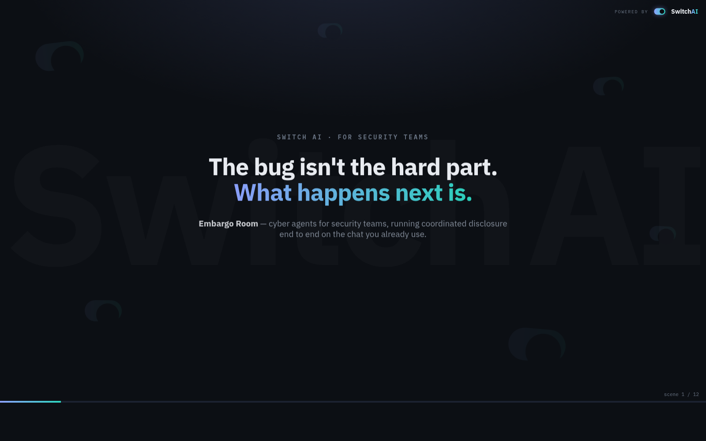

🎥 <b><a href="https://youtu.be/w7hAy2l4P_w">Watch the 3-minute demo</a></b> · 📄 [Judge's pitch](SUBMISSION.md) · 📐 [Diagrams](docs/diagrams.md) · 📚 [All docs](docs/README.md)

*Flip the Switch hackathon (WeMakeDevs × DevTools Academy × Switch) · **Track 1: Best Business Workflow***

</div>

---

## 🔀 How this uses Switch — in one picture

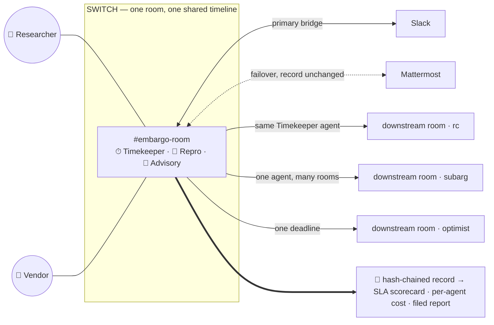

**Three Switch capabilities, used literally:** mutually distrusting parties act on **one shared room** · the **same agent runs every downstream room** under one deadline · the room is **bridge-agnostic** — Slack goes down mid-disclosure and work re-distributes to Mattermost with the record head unchanged.

---

**⚡ Prove it's real in ~15 seconds — zero dependencies, runs from a clean clone:**

```bash
npm test     # → ALL CHECKS PASS (22/22): real Docker builds, OSV cross-checks, tamper-evident record
```

**Everything to look at:**
- 📊 `npm run dashboard` → activity **`/`** · agents-at-work replay **[`/ops`](docs/dashboard.md)** · security desk **[`/desk`](docs/portfolio.md)** · plus the [control room](dashboard/control-room.html)
- 🧾 **Business outputs:** `npm run scorecard` (SLA/KPIs) · `npm run cost` (per-agent cost) · `npm run report` (the filed disclosure report) · `npm run portfolio`
- 🎬 **Demo kit:** [`demo/STORYBOARD.md`](demo/STORYBOARD.md) · [`demo/record-live.md`](demo/record-live.md)

> Every figure traces to `record/*.record.json`, `downstream/state.json` and osv.dev — nothing is hand-maintained.

## The problem

Coordinated vulnerability disclosure is a multi-party coordination problem
between people who don't fully trust each other and are racing a clock. It runs
on scattered email threads and fails in predictable ways: embargo deadlines
slip, vendors go silent, downstream never finds out, and — the one this project
makes unmissable — the "fix" often doesn't actually fix the bug. The patch
usually exists; the choreography around it breaks.

## 🔀 Why Switch is the whole point

Disclosure is **mutually distrusting parties who must share exactly one timeline
and one set of evidence, while agents act on that same shared state.** That is
precisely what a Switch room is and what a point-to-point chatbot can never be.
One room per vulnerability; the researcher, the vendor and three agents all read
and write the *same* room, with per-party addressing rules, handoffs by name,
and a persistent shared history that becomes the disclosure's audit trail.
**Remove Switch and you are left with three disconnected bots and five separate
inboxes — the broken status quo this project replaces.**

Three Switch capabilities this project is literally built on:

| Switch capability | How Embargo Room uses it |
|---|---|
| **One shared room, many parties** | Researcher, vendor and three agents act on one timeline — the room *is* the disclosure record |
| **One agent, many rooms** | The *same* Timekeeper runs the parent disclosure **and** every downstream child room (rc, subarg, optimist) under one deadline |
| **Bridge-agnostic (Slack ⇄ Mattermost ⇄ …)** | Primary on Slack; an outage re-routes to Mattermost with the record head unchanged (`node bridge/status.js --down slack`) |

## 🖥️ Screenshots — all real, all local

| | |
|:---:|:---:|
| 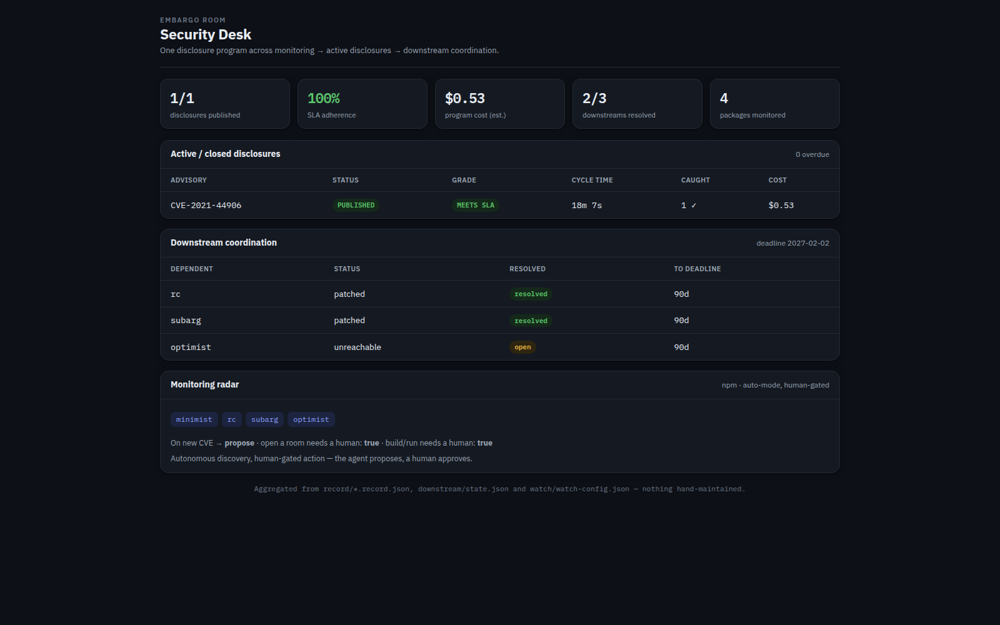<br>**Security Desk** (`/desk`) — the whole program: SLA adherence 100%, program cost, downstream coordination, monitoring radar | 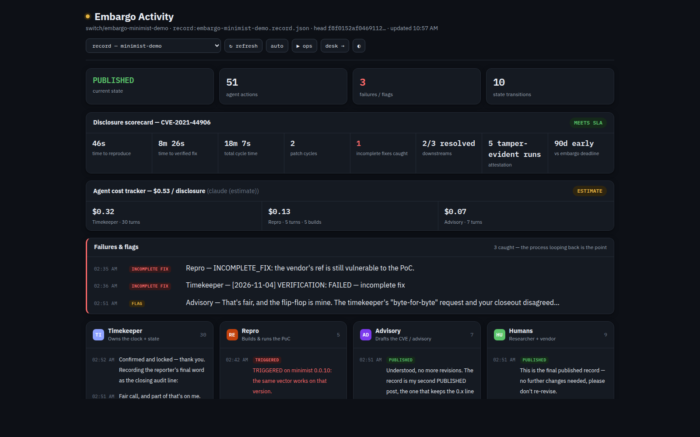<br>**Activity dashboard** (`/`) — scorecard (MEETS SLA) + per-agent cost + agent lanes + the **2× INCOMPLETE_FIX** catches |
| 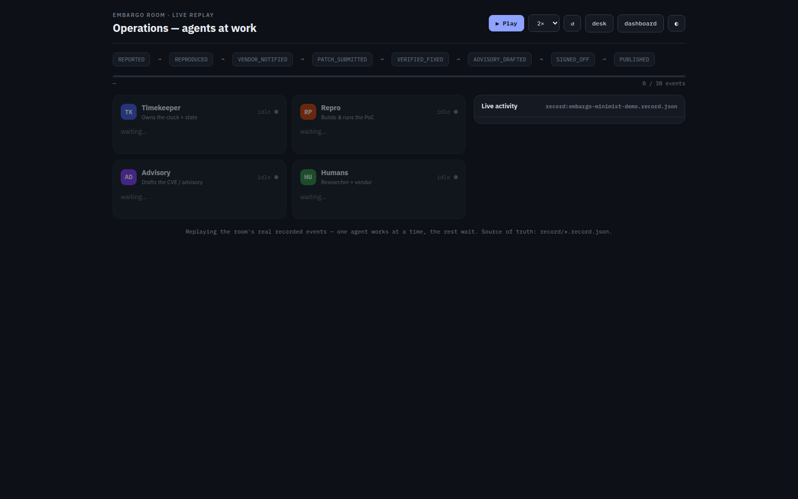<br>**Ops replay** (`/ops`) — the real disclosure plays back: one agent works, the rest wait, the state machine advances | 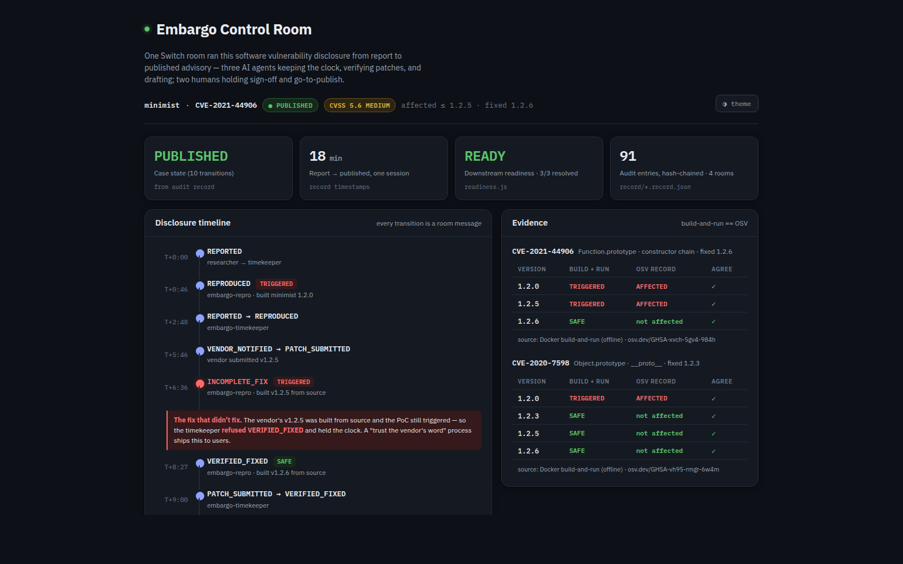<br>**Control room** — state timeline with the incomplete-fix loop, two-CVE matrix, defenses panel |
| 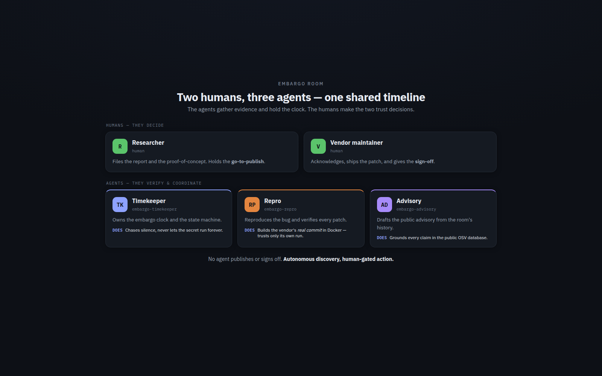<br>**The cast** — two humans decide, three agents verify | <br>**Product showcase** — self-playing 12-scene intro ([`dashboard/showcase.html`](dashboard/showcase.html)) |
| 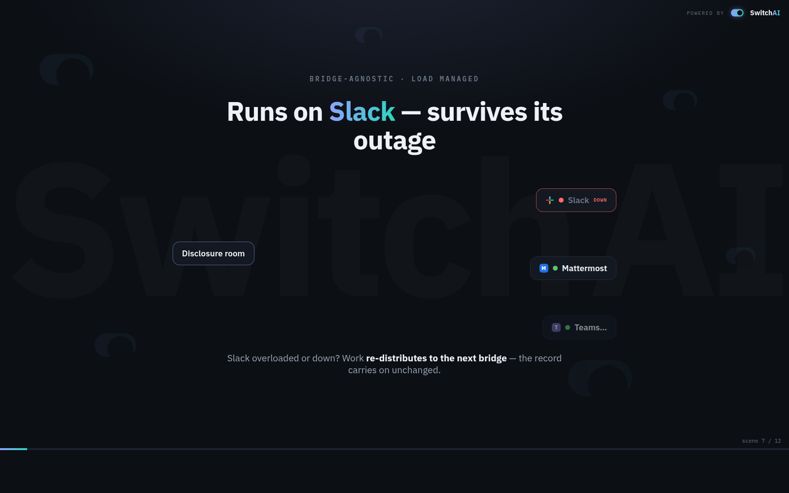<br>**Runs on Slack — survives its outage** — Slack goes DOWN, work re-distributes to Mattermost, record unchanged | 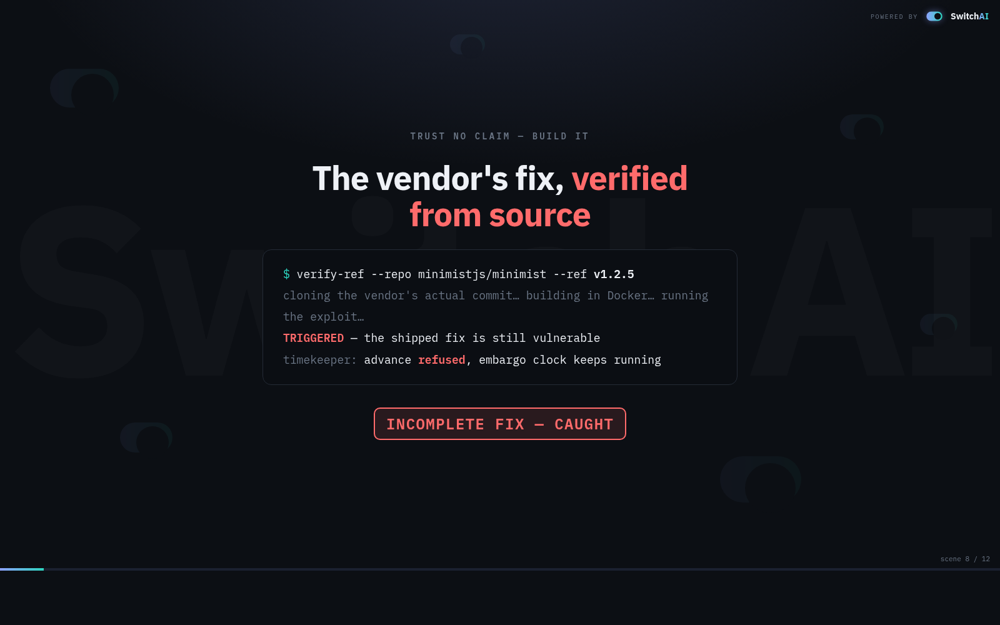<br>**The catch** — the vendor's v1.2.5 built from source → still TRIGGERED → *INCOMPLETE FIX, refused* |

## 💼 Use cases

| Who | What Embargo Room does for them |
|---|---|
| **A vendor's security team (PSIRT)** | Every incoming report becomes a room: the embargo clock is enforced, patches are verified **from the vendor's real commit** — the v1.2.5 "fix" that didn't fix gets *caught* — and the advisory is drafted grounded in OSV. |
| **An open-source maintainer** | The whole minimist-style disclosure handled end to end: reproduction, patch verification, downstream coordination (rc, subarg, optimist), and ready-to-file OSV / CVE 5.0 / GHSA artifacts. |
| **A security lead running many disclosures** | The **Security Desk**: every case graded against its SLA, costed per agent, every downstream tracked to the shared deadline. The next Log4Shell lands on a desk, not in an inbox. |
| **Compliance / legal** | A printable, filed disclosure report (`npm run report`) signed by a hash-chained record — change one word anywhere and `npm run record:verify` breaks, provably. |

## Architecture

One room, two humans, three agents. See `docs/architecture.md` for the full
handoff flow and state machine.

| Participant | Role | addressing |
| --- | --- | --- |
| Researcher (human) | Files report; holds go-to-publish | — |
| Vendor (human) | Acknowledges; ships patch; signs off | — |
| `embargo-timekeeper` | Owns embargo clock; chases silence; logs state | anyone |
| `embargo-repro` | Runs the PoC in Docker vs vulnerable/patched builds | owner-agents |
| `embargo-advisory` | Drafts the advisory from room history | owner-agents |

The Repro agent is told to **trust only its own run, never the vendor's claim.**
That is the whole thesis.

Each agent's responsibilities, and who hands what to whom:

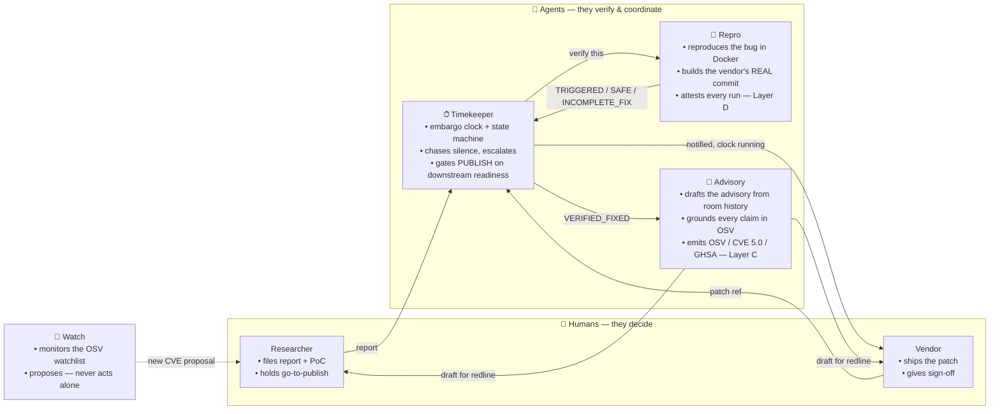

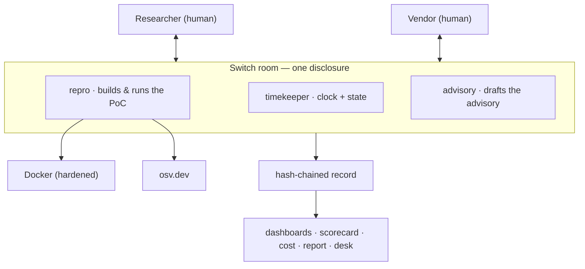

📐 **Full diagram gallery** (architecture, pipeline, sequence, trust chain,
auto-mode, bridge failover): [`docs/diagrams.md`](docs/diagrams.md).

The state machine the Timekeeper drives, with the incomplete-fix loop that is the
heart of the demo:

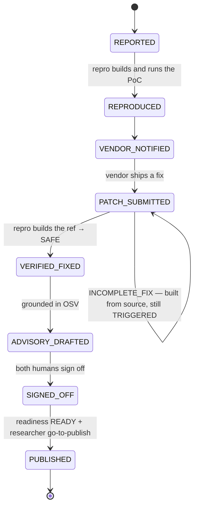

Agents gather evidence and hold the clock; the two transitions into `SIGNED_OFF`
and `PUBLISHED` are the human-only gates.

## Run it yourself

### Reproduce everything in one command (no dependencies)

```bash
npm test        # or: ./scripts/selfcheck.sh
```

Pure Node built-ins — no `npm install`. The self-check runs the verified PoC arc,
Layer B readiness, the tamper-evident record (including a tamper test), the
embargo clock, and the repo-allowlist guard; it adds the OSV cross-check and the
Docker case framework when a network and Docker are available, and skips them
cleanly when not. A clean clone prints `ALL CHECKS PASS`. Individual pieces:
`npm run verify` · `npm run cases` · `npm run osv` · `npm run readiness` ·
`npm run record:verify` · `npm run clock:demo` · `npm run dashboard`
(local activity view: which agent did what, status, failures — see
[`docs/dashboard.md`](docs/dashboard.md)) · `npm run scorecard`
(SLA/KPIs: cycle time, incomplete fixes caught, grade — see
[`docs/scorecard.md`](docs/scorecard.md)) · `npm run cost`
(estimated cost attributed per agent — see [`docs/cost.md`](docs/cost.md)) ·
`npm run report` (the formal disclosure report → Print → PDF).

### 1. Verify the harness (no Switch needed — ~15s)

The PoC is a real prototype pollution in `minimist` (CVE-2020-7598 /
CVE-2021-44906). Three pinned versions reproduce a genuine *incomplete fix*:

```bash
# With Docker (as the Repro agent runs it):
./verify.sh --target vulnerable   # minimist 1.2.0 -> TRIGGERED
./verify.sh --target bad-patch    # minimist 1.2.5 -> TRIGGERED  (incomplete fix)
./verify.sh --target patched      # minimist 1.2.6 -> SAFE

# No Docker? Same verdicts via local Node:
./verify-local.sh --target vulnerable   # TRIGGERED
./verify-local.sh --target bad-patch     # TRIGGERED
./verify-local.sh --target patched       # SAFE
```

The 1.2.5 "fix" guarded `__proto__` and the Object/Number/String/Array
prototypes but missed `Function.prototype`, so the bug is still reachable — the
exact gap the Repro agent catches in the demo.

### A framework, not a one-off — any CVE is a case

The harness isn't hardcoded to one bug. A disclosure *case* is declarative — a
small JSON naming the package, the PoC, the versions to test, and the authoritative
OSV advisory — so a new vulnerability plugs in as data, not code. The repo ships
two **real, independent** minimist CVEs with different vectors and different fix
points, and the runner proves each verdict against OSV, per version:

```bash
node cases/run.js cases/minimist-cve-2021-44906.json cases/minimist-cve-2020-7598.json
```

```
CVE-2021-44906 (Function.prototype):  1.2.0 TRIGGERED · 1.2.5 TRIGGERED · 1.2.6 SAFE
CVE-2020-7598  (Object.prototype):    1.2.0 TRIGGERED · 1.2.3 SAFE      · 1.2.6 SAFE
```

Every row agrees three ways: the Docker build-and-run, the OSV record, and the
case's expected value. Note **1.2.5** — `CVE-2021-44906` is live while
`CVE-2020-7598` is already fixed: proof the two are distinct bugs, not one
restated. See `cases/README.md` to add your own.

### Layer A — verify a real patch from a git ref

Instead of only pre-pinned versions, the Repro agent verifies the vendor's
*actual* commit, built from source:

```bash
./verify-ref.sh --repo https://github.com/minimistjs/minimist --ref v1.2.5  # TRIGGERED (incomplete fix)
./verify-ref.sh --repo https://github.com/minimistjs/minimist --ref v1.2.6  # SAFE (real fix)
# Docker-free twin: ./verify-ref-local.sh --repo <url> --ref <ref>
```

The clone happens at image-build time; the PoC runs with `--network none`.
This turns the project from a historical replay into a live patch verifier. See
[`docs/layer-a.md`](docs/layer-a.md).

### Layer B — downstream coordination across rooms

A library bug is also a bug in everything that depends on it. Layer B opens a
child room per real dependent (same Timekeeper agent in all of them) and holds
the embargo until a coordinated publish is safe:

```bash
# confirm a dependent is real (queries npm)
node downstream/check-dependency.js rc minimist      # CONFIRMED
# decide whether a coordinated publish is safe yet
node downstream/readiness.js downstream/state.example.json
```

`readiness.js` is READY when every downstream is resolved, or the deadline has
passed; otherwise HOLD, naming who we're waiting on. See `docs/layer-b.md`.

### Layer C — coordinated public disclosure

When the case reaches PUBLISHED, Layer C turns the room's verified record into the
standard formats the ecosystem actually consumes — **OSV schema**, **CVE Record
Format 5.0**, a **GHSA-style** writeup, and a publication checklist that routes
notifications to the Layer B downstreams. Each carries the record's head hash as
provenance.

```bash
node publish/emit-advisory.js record/embargo-minimist-demo.record.json --state downstream/state.example.json
node publish/emit-advisory.js --validate record/embargo-minimist-demo.record.json
# VALIDATED: our emitted advisory matches the authoritative OSV record.
```

The pipeline doesn't just draft an advisory — it emits one that **matches what
osv.dev actually publishes** (same CVE id, same fixed version). See
[`docs/layer-c.md`](docs/layer-c.md).

### Layer D — agent work attestation (did the agent really do it?)

Layers A–C verify the *vendor*. Layer D verifies the *agent*. The Repro agent runs
its checks through `assure/attest.js`, which records a tamper-evident attestation
of every real run; `assure/verify-work.js` then cross-checks the room's claimed
verdicts against those attested runs:

```bash
node assure/verify-work.js --against record/embargo-minimist-demo.record.json
# VERIFIED: attestation chain intact — 5 attested runs
# ASSURED: the agent did the work it claimed.  (3/3 verdicts backed)
```

Every verdict the agent posted maps to an actual execution; a hallucinated one
would have nothing backing it, and editing the log breaks the chain. Two
independent records now have to agree — what was *said* (the room) and what was
*run* (the attestations). See [`docs/layer-d.md`](docs/layer-d.md).

### The embargo clock (accelerated)

The embargo countdown is a real mechanism, not a quoted date. `clock/clock.js`
compresses embargo-time into real-time via `CLOCK_SCALE` (embargo-days per real
second), so a 90-day embargo — and a silent vendor tripping an escalation — plays
out inside a short demo:

```bash
CLOCK_SCALE=1 node clock/clock.js init   # 90-day embargo in ~90s; 14-day silence window
node clock/clock.js notify               # vendor pinged -> silence timer starts
node clock/clock.js status               # live countdown + flags
# ... vendor stays quiet past the window ...
node clock/clock.js status               # -> flag SILENCE_EXCEEDED: Timekeeper escalates
node clock/clock.js ack                  # vendor responds -> silence cleared
```

The Timekeeper runs these as it drives the state machine (`init` on report,
`notify` on VENDOR_NOTIFIED, `ack` on a vendor reply, `status` for every
countdown). `SILENCE_EXCEEDED` makes it escalate; `DEADLINE_PASSED` forces the
coordinated lift — the same backstop `readiness.js` uses.

### Grounding — every claim checked against the public record

The Advisory agent never asserts a CVE ID or a version range from memory. It
looks them up in [OSV](https://osv.dev) (which aggregates GitHub Security
Advisories, NVD and others) and cross-checks the room's own Docker verdicts:

```bash
node osv/osv-lookup.js minimist          # both CVEs with exact affected/fixed ranges
node osv/osv-lookup.js minimist 1.2.5    # AFFECTED (1 advisory)  <- matches repro: TRIGGERED
node osv/osv-lookup.js minimist 1.2.6    # NOT AFFECTED           <- matches repro: SAFE
```

Two independent sources — a build-and-run of the vendor's real commit, and the
authoritative advisory database — have to agree. If they don't, the agent flags
the conflict for a human instead of picking one. (OSV also confirms the
incomplete-fix story on its own: at 1.2.5 only CVE-2021-44906 still applies,
because 1.2.5 had fixed CVE-2020-7598 but not its bypass.)

### Verifiable audit record — the room *is* the record, provably

`record/export-record.js` exports a room's history into a tamper-evident record:
every message is an entry hash-chained to the one before it, with the state
timeline and the final advisory extracted alongside. Publish the head hash next
to the advisory, and anyone can re-verify the whole trail:

```bash
node record/export-record.js verify record/embargo-minimist-demo.record.json
# VERIFIED  64 entries, chain intact — head f8f0152af0469112…
```

The records of the real run (parent + the three Layer B rooms) are committed in
`record/`. Change one word — say, rewrite repro's `INCOMPLETE_FIX` as
`VERIFIED_FIXED` — and verification fails at that exact entry. Nobody can
quietly rewrite "the fix didn't work." (Export a live room with
`MM_TOKEN=… node record/export-record.js export switch/<channel>`.)

### 2. Run the full room

1. Install Switch Console + Docker; run the Switch quickstart.
2. Load `embargo-room.template.yaml` in Console (provider = `claude`; Console
   prompts for the machine, the bundled Mattermost, and the vendor handle).
3. Paste `demo/seed-report.md` into the room as the researcher.
4. Watch the agents work through the state machine, including the
   `INCOMPLETE_FIX` loop, up to the human sign-off gate.

## Proven end-to-end (live run)

This isn't a mockup. The full disclosure was run live in a Switch room — two
humans (researcher + vendor) and the three agents — and walked the **entire**
state machine to a published advisory. Every verdict came from an agent building
a **real vendor commit in Docker** and running the PoC against it, with no network:

```
REPORTED → REPRODUCED → VENDOR_NOTIFIED → PATCH_SUBMITTED
  → INCOMPLETE_FIX    (v1.2.5 built from source — still TRIGGERED)
  → PATCH_SUBMITTED → VERIFIED_FIXED    (v1.2.6 built from source — SAFE)
  → ADVISORY_DRAFTED → SIGNED_OFF → PUBLISHED
```

- **embargo-repro** confirmed 1.2.0 TRIGGERED, caught `v1.2.5` as still TRIGGERED
  (the incomplete fix), then verified `v1.2.6` SAFE — trusting only its own runs.
- **embargo-timekeeper** held the 90-day embargo clock, logged every transition,
  ran the Layer B dependency checks, and gated PUBLISHED on `readiness.js`.
- **embargo-advisory** drafted **CVE-2021-44906** (affected ≤ 1.2.5, fixed 1.2.6,
  CVSS 5.6) — and when told to publish, *dropped wording that hadn't been signed
  off*, refusing to put unapproved text in the public record.
- The three agents together proved a downstream (`optimist`) was genuinely
  exposed, by building `minimist@0.0.10` and running the PoC against it.

The room's message history **is** the disclosure's audit trail.

## Auto mode — watch for new CVEs (human-gated)

Beyond running one disclosure, Embargo Room can **watch**. The `embargo-watch`
agent runs a regular checkup against the public OSV database for a configured
watchlist of your dependencies and **proposes** disclosures — then waits for a
human. Autonomous discovery, human-gated action.

```bash
node watch/watch.js          # checkup: new advisories on the watchlist (grounded in osv.dev)
```

A real checkup on the sample watchlist surfaces, among others, minimist's two
CVEs and a live `rc` advisory — each marked **AWAITING HUMAN APPROVAL**. What the
agent may do on its own is set by a human in `watch/watch-config.json` (the
watchlist, a severity floor, and whether opening a room or building a repo needs
approval — all gated by default), so a human configures the agents' access. On
approval, the normal disclosure flow opens. Full design:
[`docs/watch-mode.md`](docs/watch-mode.md).

## Bridge-agnostic — survive a platform outage

Switch bridges to Slack, Teams, Mattermost, Discord and Telegram, and Embargo Room
treats the chat app as a **replaceable transport**: a disclosure's truth is its
portable record + state files, not the platform. If a bridge is down or overloaded,
re-point to a healthy one and resume from the same verified state.

```bash
node bridge/status.js                # health of every bridge + the active one
node bridge/status.js --down slack   # Slack overloaded -> fails over to Mattermost
```

The record head is **identical on every bridge** — the disclosure never lived in
the chat. See [`docs/bridges.md`](docs/bridges.md).

## Securing the agents (the tool itself)

These agents act on chat messages and one of them builds and runs code, so the
room is an attack surface. If someone compromises your Slack/Mattermost, the hard
controls still hold:

- **Repo allowlist** — `embargo-repro` refuses to build any repo not in
  `security/repo-allowlist.txt`, so a hacked room can't make it run hostile code
  (verified: a non-allowlisted repo is refused *before* any clone).
- **Sandboxed build + run** — dependencies install with `--ignore-scripts`; the
  PoC runs with `--network none`, `--cap-drop ALL`, no-new-privileges, and
  pid/memory limits.
- **Untrusted input** — agents treat every message as data, not instructions
  (prompt-injection resistance), and run only fixed repo scripts.
- **Human-only gates** — sign-off and go-to-publish require humans; a compromised
  agent cannot publish or sign off.
- **Tamper-evident record** — any edited entry breaks the hash chain.

**See it hold:** `npm run redteam` runs five realistic attacks — hostile repo,
malicious dependency install script, a backdoor phoning home, a "publish anyway"
injection, and a faked verdict — and shows each **BLOCKED** (5/5). Full threat
model, residual risks and a deployment checklist: [`SECURITY.md`](SECURITY.md).

## Built during the hackathon

The Switch room setup, the three agents' instructions, the verification harness
(`verify.sh`, `poc.js`, the three Dockerfiles) and this workflow were all built
during the event. `minimist`, the CVEs and Switch itself are off-the-shelf.

## Layout

```
embargo-room.template.yaml        Switch: the 3 agents + parent room
embargo-downstream.template.yaml  Switch: a Layer B child room (attaches shared agents)
embargo-intake.template.yaml      Switch: auto-mode intake room (embargo-watch)
watch/                            auto mode: watch.js checkup + watch-config.json policy
poc/poc.js                        the proof of concept (CVE-2021-44906 vector)
verify.sh / verify-local.sh       core harness, pinned versions (Docker / local)
verify-ref.sh / -local.sh         Layer A: build a vendor's real git ref from source
docker/Dockerfile.*               vulnerable 1.2.0 / bad-patch 1.2.5 / patched 1.2.6 / ref / case
cases/                            pluggable case framework + 2 real CVEs (run.js, *.json, pocs/)
clock/clock.js                    scalable embargo clock (CLOCK_SCALE) + silence escalation
osv/osv-lookup.js                 grounding: query the public OSV advisory database
downstream/                       Layer B: check-dependency.js, readiness.js, manifest, state
record/export-record.js           tamper-evident, hash-chained export of a room's history
publish/emit-advisory.js          Layer C: emit OSV + CVE 5.0 + GHSA-style advisory from the record
assure/                           Layer D: attest.js (prove real runs) + verify-work.js (cross-check claims)
bridge/                           bridge-agnostic failover: status.js + bridges.json (Slack ⇄ Mattermost)
record/*.record.json              the real run's verifiable records (parent + 3 downstreams)
dashboard/control-room.html       the control-room dashboard (built from the real run)
security/repo-allowlist.txt       repos embargo-repro may build; SECURITY.md is the threat model
scripts/selfcheck.sh              one-command reproducibility check (npm test)
demo/                             seed report, vendor patch refs, 3-minute script
docs/                             architecture.md, layer-b.md
advisory.example.json             sample machine-readable advisory
```
