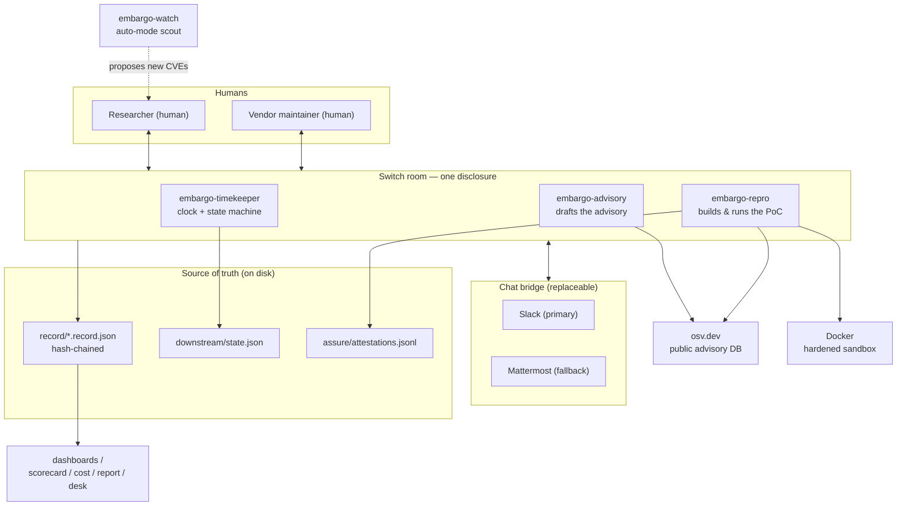
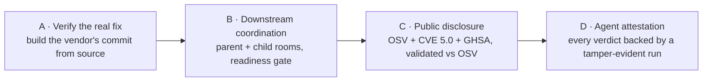
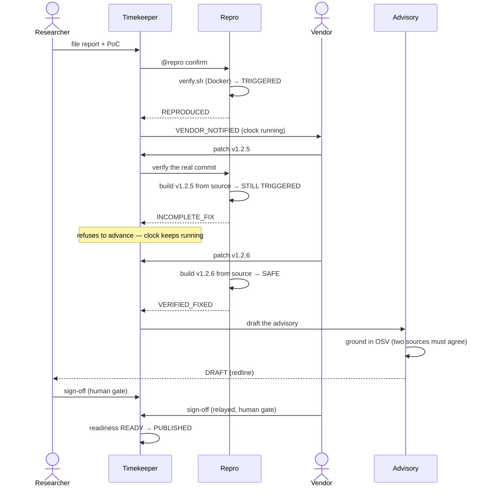
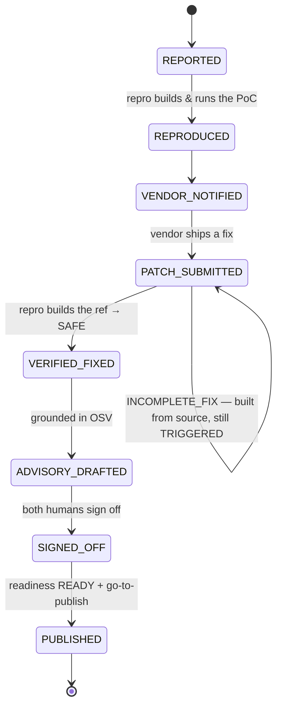
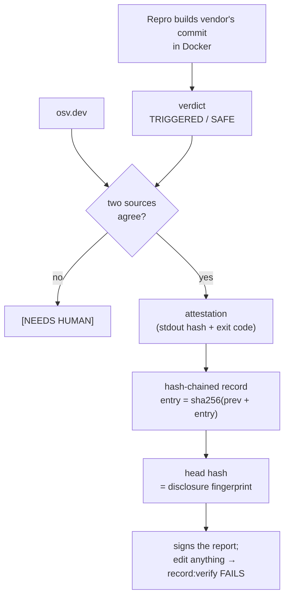
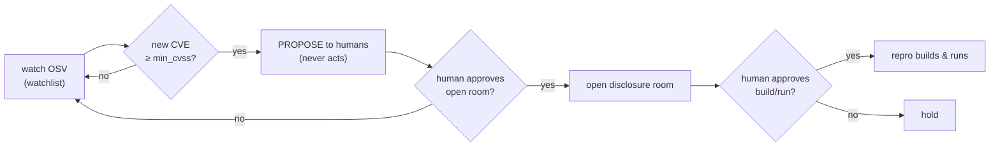
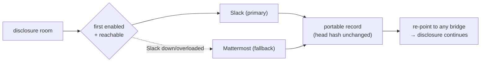
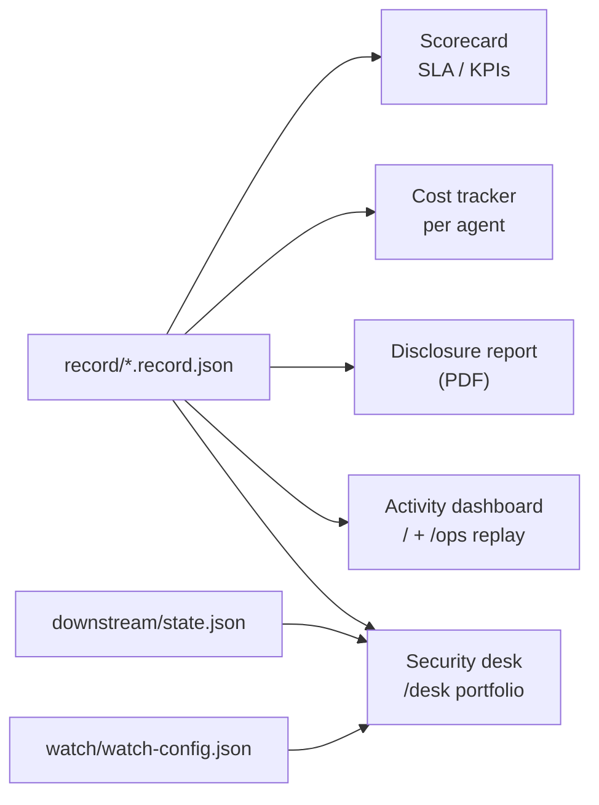

# Diagrams

Every diagram here renders on GitHub (Mermaid). They describe the real system —
the same components you run with `npm test`, `npm run dashboard` and the room.

- [1. System architecture](#1-system-architecture)
- [2. The A → B → C → D pipeline](#2-the-a--b--c--d-pipeline)
- [3. Disclosure sequence (report → published)](#3-disclosure-sequence-report--published)
- [4. State machine](#4-state-machine)
- [5. Trust & tamper-evidence](#5-trust--tamper-evidence)
- [6. Auto-mode — autonomous discovery, human-gated action](#6-auto-mode--autonomous-discovery-human-gated-action)
- [7. Bridge-agnostic failover](#7-bridge-agnostic-failover)
- [8. From record to business outputs](#8-from-record-to-business-outputs)

---

## 1. System architecture

One Switch room per disclosure: two humans and three agents on one shared
timeline, with a watch agent feeding new work in. The chat bridge is replaceable;
the disclosure's truth is the on-disk record + state.

---

## 2. The A → B → C → D pipeline

Trust-but-verify, applied to the vendor *and* the agent.

---

## 3. Disclosure sequence (report → published)

The incomplete-fix loop is the heart of it: the agent builds the vendor's *actual
commit* and it still triggers, so the Timekeeper refuses to advance.

---

## 4. State machine

---

## 5. Trust & tamper-evidence

Two independent sources must agree, every verdict is attested, and the whole
history is a hash chain that a single edit breaks.

---

## 6. Auto-mode — autonomous discovery, human-gated action

The agent discovers on its own; every consequential action waits for a human.

---

## 7. Bridge-agnostic failover

The disclosure's truth is the portable record, not the chat platform.

---

## 8. From record to business outputs

One hash-chained record; every management view is derived from it, so nothing is
hand-maintained.

